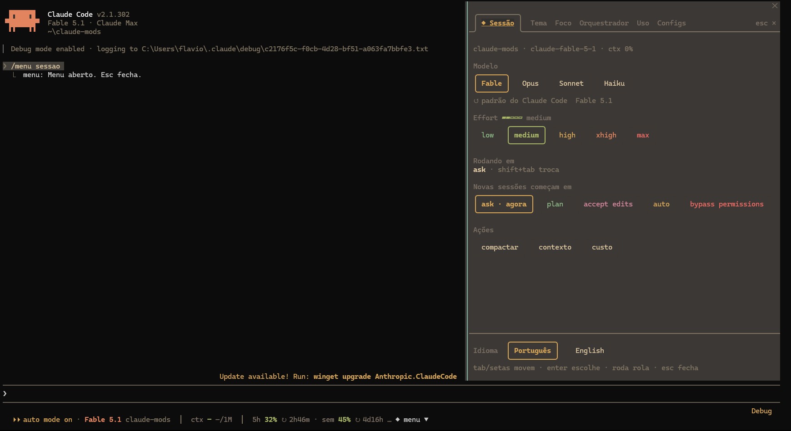
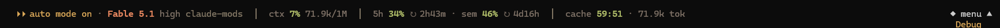
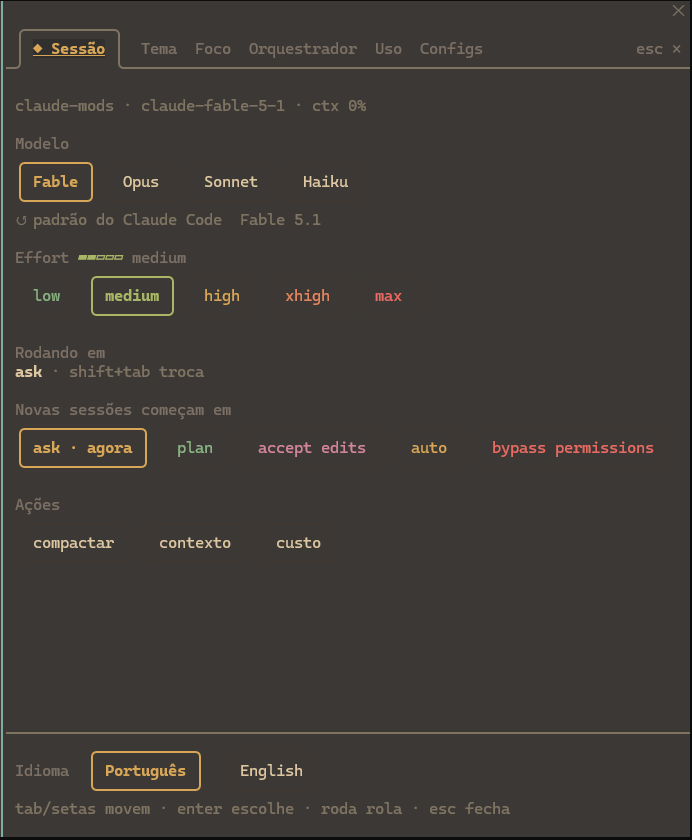
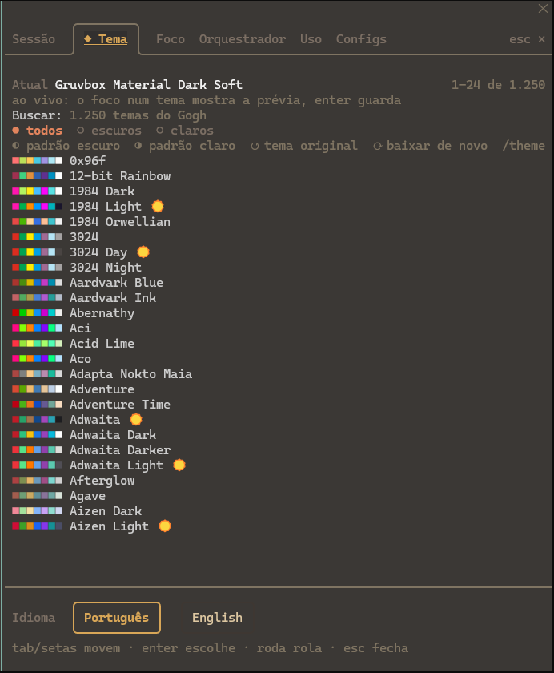
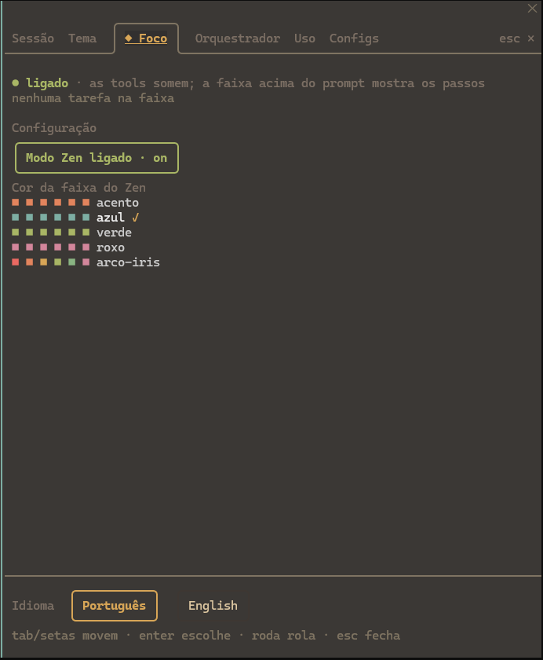
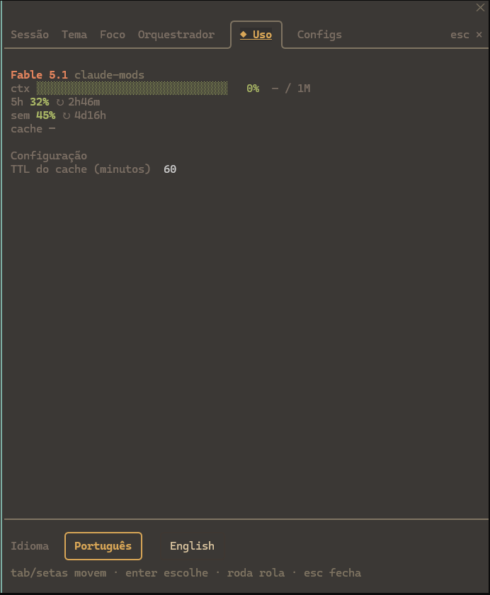
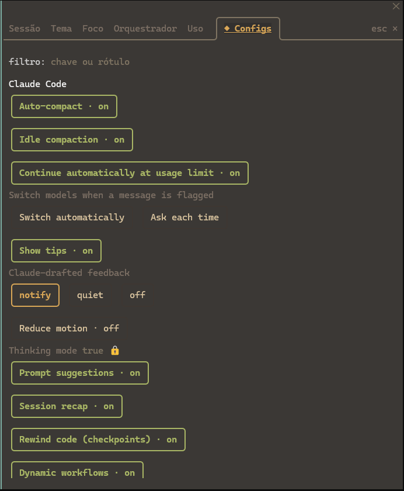
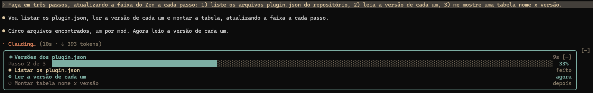
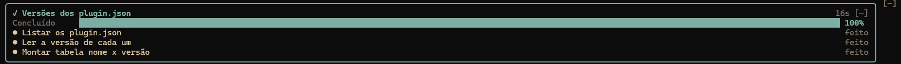
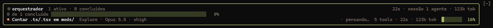

<div align="center">

# claude-mods

**Mods para o [Claude Code](https://claude.com/claude-code): uma régua de uso sob o prompt, um painel de agentes, o Modo Zen e um menu com abas, temas e todas as configurações.**

[](LICENSE)
[](https://claude.com/claude-code)
[](#instalação)
[](#menu)



</div>

São plugins de *function hooks*: módulos que o Claude Code carrega dentro da própria interface e que desenham no terminal, reagem aos eventos da sessão e expõem configurações pelo `/config`. Nada roda fora do processo do Claude Code, nada é enviado para fora.

## Sumário

- [Os mods](#os-mods)
- [Instalação](#instalação)
- [terminal-hud](#terminal-hud): régua de uso sob o prompt
- [menu](#menu): abas, temas e configurações
- [zen](#zen): Modo Zen com faixa de progresso
- [orquestrador](#orquestrador): painel de agentes
- [Perguntas frequentes](#perguntas-frequentes)
- [Desenvolvimento](#desenvolvimento)
- [Créditos e licença](#créditos-e-licença)

## Os mods

| Mod | O que faz | Onde aparece |
| --- | --- | --- |
| [**terminal-hud**](#terminal-hud) | Modelo, effort, projeto, contexto, limites de uso (5h, semana, por modelo) e validade do prompt cache, numa linha. | Sob o prompt, na linha da dica `? for shortcuts`. |
| [**menu**](#menu) | Janela com abas: Sessão (modelo, effort, modo), Tema (1.250 temas com troca ao vivo), Foco, Orquestrador, Uso e Configs. Em português ou inglês. | Botão `◆ menu` sob o prompt, ou `/menu`. |
| [**zen**](#zen) | Modo Zen: esconde as chamadas de tool e mostra uma faixa de progresso com os passos do plano. | Faixa acima do prompt. |
| [**orquestrador**](#orquestrador) | Árvore dos agentes ativos: tipo, modelo, effort, tool em voo, tokens e contexto de cada um. | Faixa acima do prompt ou painel ao lado da transcrição (`/orq`). |
| **pacote** | Só dependências: instala os quatro de uma vez. | Nenhum lugar: não tem código. |

Os mods compõem entre si. Na linha sob o prompt a régua do hud encolhe para o botão do menu caber; acima do prompt a faixa do zen e a do orquestrador se empilham; o menu lê o estado dos outros três nas abas Foco, Orquestrador e Uso.

## Instalação

Na prompt de uma sessão do Claude Code no terminal, tudo de uma vez:

```
/plugin install pacote --marketplace FLCordis/claude-mods
```

Responda `y` para adicionar o marketplace e escolha o escopo (`user` vale para todas as sessões). Os mods passam a valer na hora, sem reiniciar. O `pacote` não tem código: só depende dos quatro mods, e o Claude Code instala e liga os quatro junto.

Ou um por um:

```
/plugin install terminal-hud --marketplace FLCordis/claude-mods
/plugin install menu --marketplace FLCordis/claude-mods
/plugin install zen --marketplace FLCordis/claude-mods
/plugin install orquestrador --marketplace FLCordis/claude-mods
```

**Configurar.** Cada mod declara suas opções no manifesto; o Claude Code pergunta na instalação e todas ficam no `/config` e na aba Configs do menu. Dá para responder depois com `/plugin configure <mod>@flcordis-mods`. Nenhuma opção é obrigatória: em branco, vale o padrão.

**Desligar um mod.** Cada um continua um plugin próprio. Enquanto o `pacote` está ligado, o Claude Code recusa desligar um mod que ele depende; desligue o pacote primeiro (isso não mexe nos mods) e depois o mod:

```
/plugin disable pacote@flcordis-mods
/plugin disable zen@flcordis-mods
```

Ou pelo painel `/plugin`. O Modo Zen também liga e desliga pela própria opção `enabled`, sem mexer no plugin.

**Atualizar.** `/plugin marketplace update flcordis-mods` e depois `/plugin update <mod>@flcordis-mods`, ou pelo painel `/plugin`.

**Requisitos.** Claude Code 2.1.302 ou mais novo (os mods usam a API de *function hooks*), no terminal ou no app desktop. A troca do fundo do terminal pelo menu só funciona no Windows Terminal; o resto é igual em qualquer terminal.

## terminal-hud

Uma régua de uma linha **abaixo** da caixa de texto, na linha da dica `? for shortcuts`. O indicador de modo de permissão do próprio Claude Code continua no início dela, e o botão do menu, quando instalado, fica na ponta direita.



| Grupo | O que mostra |
| --- | --- |
| **sessão** | Modelo, nível de effort e o projeto (pasta raiz da sessão). |
| **ctx** | Porcentagem da janela de contexto e tokens usados / janela. Amarelo a partir de 70%, vermelho a partir de 90%. |
| **limites** | `5h` e `sem` (semanal) vêm nos headers de cada resposta da API. As janelas por modelo (`sem fable`, `sem opus`…) vêm do endpoint de uso da conta, o mesmo que o `/usage` consulta, lido a cada minuto com a credencial da sessão (o mod recebe só um handle; o segredo fica no host). Cada uma com o tempo até o reset (↻). |
| **cache** | Contagem regressiva até o prompt cache expirar. Verde, amarelo nos últimos 5 minutos e **vermelho** quando expira, avisando quantos tokens o próximo prompt vai reescrever. Enquanto o Claude trabalha, `cache renovando`. |

**Configuração.** Ao instalar, o Claude Code pergunta o único campo do mod, `cacheTtlMinutes` (TTL do cache, em minutos). Pode deixar em branco: vale o padrão, `60`, que é a validade do cache na assinatura. Coloque `5` só em uso excedente ou via API. Dá para mudar depois em `/config` ou na aba Uso do menu.

**Limitações.**

- O Claude Code não informa quando o cache expira. O mod marca a hora da última resposta da conversa principal e soma o TTL configurado.
- Os limites dos headers chegam com a primeira resposta da sessão; até lá a régua mostra "limites aguardando 1ª resposta". As janelas por modelo dependem de login na conta (não aparecem com chave de API ou gateway) e de `CLAUDE_CODE_DISABLE_NONESSENTIAL_TRAFFIC` desligado; quando a consulta falha, o motivo aparece no lugar delas.
- Subagentes têm cache próprio e não renovam a contagem.
- A régua corta à direita quando a janela é estreita; outros mods que desenham na mesma linha (o botão `◆ menu`) ficam depois dela, e ela encolhe para tudo caber numa linha só.

## menu

Uma janela com abas, aberta pelo botão `◆ menu ▲` na ponta direita da linha sob o prompt ou por `/menu` (`/menu tema` abre direto numa aba; os nomes em inglês e os antigos, `zen` e `hud`, também valem). O mesmo botão fecha (`▼`). As abas são desenhadas como as de um navegador: a ativa numa caixa que se emenda na régua, as outras só em texto, e `esc ×` na ponta. Tudo funciona com o teclado (Tab e setas andam, Enter escolhe, a aba ativa já vem focada) e com o mouse. Em tela cheia com 110 colunas ou mais ela encosta ao lado da transcrição; fora disso aparece acima do prompt. A última aba aberta e o idioma (Português ou English, no rodapé) são lembrados entre sessões.

<table>
<tr>
<td></td>
<td></td>
</tr>
<tr>
<td align="center"><b>Sessão</b></td>
<td align="center"><b>Tema</b></td>
</tr>
<tr>
<td></td>
<td></td>
</tr>
<tr>
<td align="center"><b>Foco</b></td>
<td align="center"><b>Uso</b></td>
</tr>
</table>

| Aba | O que mostra |
| --- | --- |
| **Sessão** | Modelo (clique troca, via `/model`). Effort: o escolhido vale para cada requisição da sessão (o mod reescreve o effort no hook `turn.step`), fica guardado para as próximas sessões e, quando o `/config` tem a linha, ela é atualizada junto. O modo de permissão em vigor (só leitura: shift+tab troca) e o modo com que **novas sessões** começam (grava `permissions.defaultMode` no `settings.json` de usuário, preservando o resto). Ações: compactar, `/context` e `/cost`. |
| **Tema** | Os 1.250 temas do [Gogh](https://github.com/Gogh-Co/Gogh) (Dracula, Nord, Catppuccin, Tokyo Night, Gruvbox…), baixados uma vez para `~/.claude/menu/gogh-themes.json`. Busca, filtro claro/escuro e uma lista com amostras das cores que rola sozinha (roda do mouse, setas, ou o foco andando por ela). Clique ou Enter num tema aplica: vira o tema customizado `~/.claude/themes/menu.json` (todos os tokens de cor do Claude Code, ajustados para ler no fundo) e fica em vigor como `custom:menu`. Com o foco parado num tema, a **prévia** pinta na hora sem guardar; fechar o menu ou sair da aba volta ao tema guardado. No **Windows Terminal**, o perfil da aba recebe o esquema `claude-menu` com o fundo do tema, e volta ao esquema dele quando a sessão termina. Também: padrão escuro/claro (o tema base, ao vivo), voltar ao tema de antes do menu e o seletor nativo `/theme`. |
| **Foco** | Liga e desliga o mod [zen](#zen) e escolhe a cor da faixa (uma linha por cor, com a amostra e ✓ na escolhida), e mostra a tarefa que a faixa acompanha. |
| **Orquestrador** | A sessão principal e uma linha por agente (recuo por nível, `✔`/`✖` para concluído/falhou), lidas do estado do mod [orquestrador](#orquestrador), e abaixo as configurações dele. |
| **Uso** | Modelo, effort e projeto, barra de contexto, os limites (`5h 37% ↻ 2h20m`, `sem fable 20%`) e o cache, lidos do estado do [terminal-hud](#terminal-hud), e abaixo as configurações dele. |
| **Configs** | Um filtro e todas as linhas do `/config`, agrupadas por dono (Claude Code primeiro, depois cada plugin): booleano vira chip on/off, escolha vira chips (ou um seletor quando há muitas), número e texto viram campo com Enter para gravar; linha travada por política aparece com 🔒. No fim, chips que fecham o menu e abrem os painéis nativos (`plugins`, `permissions`, `mcp`, `hooks`, `memory`, `usage`…), só os que a sessão tem. |

<details>
<summary>Aba Configs</summary>

</details>

Toda ação deixa uma linha de nota acima do rodapé (`modelo → opus`, `modo padrão → plan (settings.json)`, `tema → Nord`, `recusado: …`). Antes da primeira gravação no `settings.json` do Claude Code ou do Windows Terminal, o mod guarda uma cópia ao lado, em `settings.json.menu.bak`.

**Configuração.** O menu não tem opções próprias; o idioma fica no rodapé e as opções dos outros mods aparecem nas abas deles.

**Limitações.**

- Não há API para trocar o modo de permissão da sessão em andamento: a aba mostra o modo atual e o shift+tab continua sendo o caminho. O que o menu grava é o modo das próximas sessões.
- O clique no botão `◆ menu` funciona no terminal em tela cheia (onde o Claude Code repassa cliques); fora dela, use `/menu`.
- **Tema, primeira vez:** o Claude Code só passa a acompanhar o arquivo `~/.claude/themes/menu.json` quando o tema `custom:menu` já estava em vigor ao iniciar. A primeira escolha grava `theme: "custom:menu"` no `settings.json` e pede para reiniciar o Claude Code uma vez; daí em diante toda troca (e a prévia) é ao vivo. Trocar o tema pelo `/theme` desliga isso até a próxima escolha no menu.
- **Windows Terminal:** o mod reescreve o `settings.json` do WT (comentários do arquivo não são mantidos; o original fica no `.menu.bak`). Um perfil com `background` próprio ignora o fundo do esquema. Várias sessões no mesmo perfil dividem o esquema, e o original volta quando a última delas fecha (uma sessão que caiu sem fechar deixa de contar depois de 3 minutos). Fora do Windows Terminal só as cores do Claude Code mudam.
- As abas Foco, Orquestrador e Uso precisam dos mods instalados; sem eles, a aba diz qual mod não está carregado e como instalar (as configurações continuam editáveis).
- Comandos e painéis rodam quando a sessão fica ociosa; numa recusa, o menu fica aberto e a nota mostra a razão.
- No celular (Claude Code mobile) os campos de texto viram só leitura; o resto funciona por toque.

## zen

Modo Zen: as chamadas de tool e o que elas devolvem somem da transcrição (ficam só as mensagens de texto do Claude), e uma faixa **acima** do prompt mostra o andamento com os passos do plano.





| Parte | Como funciona |
| --- | --- |
| **Faixa** | Cada rodada da sessão principal abre uma tarefa com o prompt como título, o tempo decorrido e uma barra de progresso. No fim a faixa marca concluído (ou interrompido, num Esc ou erro) e some alguns segundos depois. `[–]` recolhe numa linha, `[+]` abre de novo. |
| **Passos** | Com o Zen ligado, cada prompt digitado leva ao Claude uma instrução (nunca mostrada) para manter o plano por uma tool própria, `mcp__zen__progress`, com o plano inteiro a cada chamada. A lista de tarefas do próprio Claude Code (TodoWrite, TaskCreate, TaskUpdate) também move a faixa. Subagentes não mexem nela. |
| **Tools escondidas** | `ToolUse`, `ToolResult`, `ToolProgress` e grupos recolhidos não são desenhados; um grupo expandido com ctrl+o aparece. |

**Configuração.** Ao instalar, o Claude Code pergunta `enabled` (ligado ou não; padrão desligado) e `bandColor` (`acento`, `azul`, `verde`, `roxo` ou `arco-iris`). Os dois também estão na aba Foco do menu e no `/config`; ligar ou desligar recarrega o mod.

**Limitações.**

- A faixa depende do Claude chamar a tool: num prompt que ele resolve sem plano, fica só o título, o tempo e a barra em 0% até o fim.
- Desligado, o mod não registra a tool nem muda o prompt: nada do Zen chega ao Claude.
- Com uma pesquisa de satisfação do Claude Code acima do prompt, a faixa cede a linha.

## orquestrador

A árvore de agentes e subagentes ativos, em dois lugares.

**Faixa acima do prompt** (padrão): uma caixa enquanto houver agente, e nada quando não há. Borda verde; amarela se algum agente passar de 80% de contexto, vermelha se algum falhar. Título com a contagem e, à direita, o tempo desde o primeiro agente e o total da sessão; a barra mostra a fração de agentes concluídos; cada linha é um agente, com o estado alinhado à direita.



**Pane com cartões** à direita da transcrição (modo tela cheia), aberto por `/orq`, ou sozinho no primeiro agente com `placement: pane`:

```
❯ orquestrador                       2 ativos · 1 concluído
 ● principal                          Fable 5.1 · high
 ctx ████████░░░░░░░░░░░░░░░░░░░  27%  272k / 1M
╭──────────────────────────────────────────────────────╮
│ ● backend: API de agenda                        2m10s │
│ savvy-heavy · Opus 5.5 · xhigh      9 tools · 61k tok │
│ ▸ Edit service.ts                                tool │
│ ctx ████████████░░░░░░░░░░░░░░░░  58%  116k / 200k    │
╰──────────────────────────────────────────────────────╯
  ╭────────────────────────────────────────────────────╮
  │ ● Explorar schema do banco                     22s │
  │ Explore · Sonnet 5.5 · medium     3 tools · 12k tok │
  │ · pensando…                                 modelo │
  │ ctx ███░░░░░░░░░░░░░░░░░░░░░░░░░  12%  24k / 200k  │
  ╰────────────────────────────────────────────────────╯
  ✔ Testes do hud            38k tok · 1m02s · 4 reads · 1 edits
──────────────────────────────────────────────────────────
 sessão                                 4 agentes · 412k tok
```

| Parte | O que mostra |
| --- | --- |
| **cabeçalho** | Quantos agentes rodam e quantos concluíram ainda à vista. |
| **principal** | Modelo e effort da sessão, e a barra de contexto dela. |
| **cartão** | Um por agente em andamento, com a borda na cor do tipo (cada tipo ganha uma cor na primeira vez que aparece). Linha 1: a descrição que o orquestrador deu e o tempo rodando. Linha 2: tipo, modelo e effort; tools chamadas e tokens gastos. Linha 3: a tool em voo (`▸ Grep schema.prisma`) ou `pensando…`. Linha 4: contexto usado na última requisição, amarelo a partir de 70%, vermelho a partir de 90%. |
| **recuo** | Subagente de um agente recua duas colunas por nível: a árvore mostra de quem cada um nasceu. |
| **concluído** | Vira uma linha apagada com `✔`, custo final, duração e contagem de reads/edits; falha vira `✖` vermelho com toast. Some depois de 30 segundos. |
| **rodapé** | Total de agentes e tokens da sessão, somando os que já sumiram. |

Fora do painel: um toast quando um subagente passa de 80% do contexto, e uma linha de status (`⚙ 3 agentes · 412k tok`) quando, no modo `pane`, o painel não cabe na tela.

**Configuração.** Em `/config`: `placement` (`band`, padrão, ou `pane`), `doneLingerSeconds` (30), `contextWarnPercent` (80) e `columns` (48, largura do pane em tela cheia).

**Limitações.**

- Não há progresso real: o Claude Code não diz quanto falta para um agente terminar. O que aparece é o proxy tools · tempo · tokens e o estado (tool ou modelo).
- A janela de contexto de um subagente não é informada. O mod assume 1M para modelos com `[1m]` no nome e 200k para os demais.
- No terminal, o painel encosta ao lado da transcrição só em tela cheia com 110 colunas ou mais (144 quando abre sozinho, até o primeiro `/orq` da sessão). Fora disso aparece acima do prompt.
- Agentes que não passam pela tool Agent (um fork de skill) entram pela reconciliação de 5 em 5 segundos, sem modelo até a primeira resposta.

## Perguntas frequentes

**A régua do hud não aparece.** Ela ocupa a linha da dica sob o prompt; se a janela for muito estreita ela corta à direita. Rode `/reload-plugins` depois de instalar ou atualizar e confira em `/plugin` se `terminal-hud@flcordis-mods` está ligado.

**O botão `◆ menu` não responde ao clique.** O Claude Code só repassa cliques em tela cheia no terminal. Use `/menu`, ou o teclado dentro do menu.

**Escolhi um tema e o Claude Code pediu para reiniciar.** Só na primeira vez: o tema `custom:menu` precisa estar em vigor ao iniciar para o Claude Code acompanhar o arquivo. Depois disso toda troca é ao vivo.

**Quero o menu em inglês.** No rodapé do menu, `English`. A escolha fica guardada.

**Como desligo só um mod?** Desligue o `pacote` primeiro (ele só depende dos mods, desligá-lo não muda nada) e depois o mod. Veja [Instalação](#instalação).

**O que o mod envia para fora?** Nada além do que o próprio Claude Code já faz. O hud lê o endpoint de uso da conta com a credencial da sessão (ele recebe só um handle; o segredo fica no host) e o menu baixa o catálogo de temas do Gogh, no GitHub, uma vez.

## Desenvolvimento

```
claude-mods/
├── .claude-plugin/marketplace.json   # o marketplace flcordis-mods, uma entrada por mod
├── mods/
│   ├── terminal-hud/                 # cada mod: .claude-plugin/plugin.json, hooks/, types/, tests/
│   ├── menu/
│   ├── zen/
│   ├── orquestrador/
│   └── pacote/                       # só o manifesto, com as dependências
└── docs/img/                         # as capturas deste README
```

Para editar e ver o resultado nas suas sessões, cadastre o clone como marketplace local:

```
git clone https://github.com/FLCordis/claude-mods
claude plugin marketplace add ./claude-mods
claude plugin install pacote@flcordis-mods
```

O Claude Code lê os mods direto da pasta: edite e rode `/reload-plugins`.

Verificações, por mod:

```
claude plugin validate mods/<nome>
claude plugin test mods/<nome>
```

`validate` lê o manifesto e o módulo como o engine vai ler e aponta o que seria recusado; `test` roda os testes em `tests/*.test.ts` com o harness do próprio Claude Code (sem rede, sem sessão real). Os tipos da API ficam em `<mod>/.claude-plugin/types/` depois da primeira carga (gerados pelo Claude Code e fora do Git), e `tsc -p mods/<nome>` checa os tipos.

Para adicionar um mod: crie a pasta em `mods/`, inclua uma entrada em `.claude-plugin/marketplace.json`, uma seção neste README e, se quiser que o pacote o instale, o nome em `mods/pacote/.claude-plugin/plugin.json`.

## Créditos e licença

Os temas são do [Gogh](https://github.com/Gogh-Co/Gogh) (MIT), cada um dos seus autores. O botão sob o prompt, a troca de tema ao vivo pelo arquivo customizado, o fundo do Windows Terminal e o Modo Zen foram inspirados no [ClaudeMods de Jhonatan de Souza](https://github.com/Jhonatan-de-Souza/ClaudeMods); o código aqui é próprio.

[MIT](LICENSE) · Flávio Magalhães
